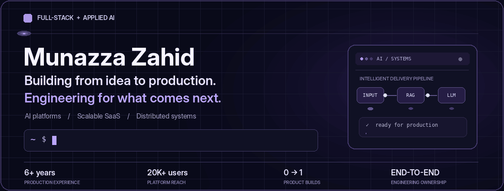

<!--
  Animated GIF header runs on GitHub without JavaScript.
  GitHub profile README — Munazza Zahid
  Designed as a companion to https://portfolio-webdeveloper-website.vercel.app/
  Keep assets/portfolio-animated.gif in this repository for the banner to render.
-->

  

### Engineering products that work beyond the demo.

I'm a Full-stack and applied AI engineer. I partner with founders and teams to turn complex ideas into products people can actually use — from architecture and the first release to production reliability and growth.

My work spans **AI systems, SaaS platforms, real-time applications, and distributed backends**. I care about the decisions behind the code: what to build, what to simplify, and how to make it last.

---

### Selected work

01 / PRODUCTION AI

**[Xenara AI](https://www.xenara.ai/)** — RAG, agents & production AI infrastructure  
Led engineering across AI workflows, retrieval pipelines, backend services, and product integrations for a customer-support platform reaching **20K+ users**, including **7K+ active users**.  
`Python` `FastAPI` `Pinecone` `Next.js`

02 / ZERO-TO-ONE PLATFORM

**[BEIZ](https://mybeiz.com/)** — Professional network & marketplace  
Helped build a product from the ground up across networking, marketplace experiences, messaging, payments, and access control. Contributed to a launch with **10K+ users** and **140+ responsive screens**.  
`Next.js` `Python` `PostgreSQL` `Stripe`

03 / DISTRIBUTED SYSTEMS

**[Online Mart](https://github.com/Stackly-X/Online-Mart-Microservices-Architecture-Project)** — Event-driven commerce microservices  
Designed a commerce backend with **six independently defined services**, asynchronous Kafka communication, dedicated persistence, and containerized deployment.  
`FastAPI` `PostgreSQL` `Kafka` `Docker` · [Explore code ↗](https://github.com/Stackly-X/Online-Mart-Microservices-Architecture-Project)

04 / APPLIED AI

**[AnswerLens](https://github.com/mzbit8890/Answerlens)** — AI brand evidence & recommendation readiness  
Built an agentic analysis workflow for assessing brand evidence and identifying gaps in AI-driven recommendations.  
`LangGraph` `FastAPI` `Gemini` `PostgreSQL` · [Explore code ↗](https://github.com/mzbit8890/Answerlens)

---

### What I build with

| Focus | Tools & technologies |
| :--- | :--- |
| **Interfaces & product** | TypeScript, React, Next.js, Tailwind CSS |
| **APIs & systems** | Python, FastAPI, Node.js, PostgreSQL, Redis |
| **Applied AI** | LLM APIs, RAG, Pinecone, LangGraph, Vertex AI |
| **Infrastructure** | Docker, Google Cloud, CI/CD, Kafka |

### How I approach engineering

**Understand & architect** → **Build & validate** → **Launch, improve & scale**

I balance shipping speed with maintainability, security, reliability, and the needs of real users.

---

  <b>Have a product to build or improve?</b> 
  Let's turn it into something people can rely on.  

Build for today. Design for what comes next.

